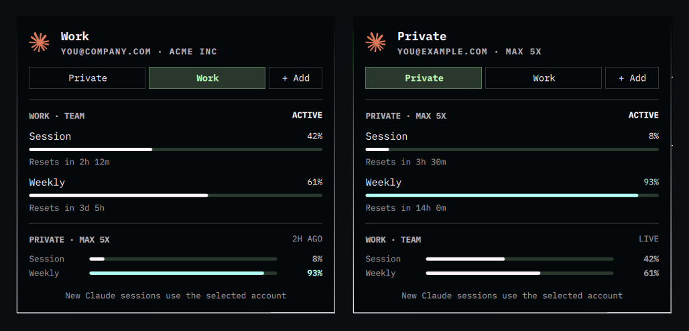

# Seats for Claude Code

Switch [Claude Code](https://claude.com/claude-code) between several
subscriptions, for example a work Team seat and a private Pro/Max plan, with
one click, and see every account's limits side by side. Runs on **macOS** (menu
bar) and **Linux**: a bar widget on [Omarchy](https://omarchy.org/), and a CLI
on any distribution.



## What it does

- **One click to switch.** Each saved login gets a button, and the active one
  is highlighted. New `claude` sessions use the selected account.
- **Every account's limits at a glance.** The active account's session and
  weekly usage are shown in full, and the others as a compact table, so you
  can see which one has room left.
- **A prompt to switch near a limit.** When the active account crosses a
  threshold (90% by default) and another account has room in the same window,
  you get a notification. Click it to switch.
- **Add accounts from the widget.** **+ Add** opens a terminal that runs
  `claude auth login` and saves the result under a name you choose.
  Right-clicking an account lets you log in to it again.
- Feels native on each platform: a standard menu on macOS, and a widget on
  Omarchy that matches the built-in Agents panel and follows your theme.


## Install

📖 **Documentation: [the wiki](https://github.com/Manzozorry/claude-seats/wiki)**, covering
installation, configuration, the CLI, how it works, security and
troubleshooting. A plain-text copy of the installation guide is in
[docs/INSTALL.md](docs/INSTALL.md).

**Linux (Omarchy)**

```bash
omarchy plugin add https://github.com/Manzozorry/claude-seats --enable
```

**Other Linux** (CLI only): see
[Installation on Linux](https://github.com/Manzozorry/claude-seats/wiki/Installation-on-Linux#other-distributions).

**macOS** (installs [SwiftBar](https://swiftbar.app) if needed)

```bash
git clone https://github.com/Manzozorry/claude-seats.git
cd claude-seats && ./macos/install.sh
```

Then save the account you're logged in with now (**Save this login**) and add
the other one with **+ Add**.

## On macOS

The menu-bar version shows the same things in a native menu:

```
👤 Work
├─ Work
│  you@company.com · Acme Inc
├─ SWITCH ACCOUNT
│  ✓ Work                      ▸ email · Log in again…
│    Private                   ▸ email · Log in again…
│  + Add account…
├─ WORK · TEAM — ACTIVE
│  Session  ▰▰▰▰▰▱▱▱▱▱▱▱   42%
│  Resets in 2h 12m
│  Weekly   ▰▰▰▰▰▰▰▱▱▱▱▱   61%
│  Resets in 3d 5h
├─ PRIVATE · MAX 5X — 2H AGO
│  Session  ▰▱▱▱▱▱▱▱▱▱▱▱    8%
│  Weekly   ▰▰▰▰▰▰▰▰▰▰▰▱   93%
└─ Refresh limits
```

Logins are kept in the macOS Keychain, the same place Claude Code keeps its
own.

## Controls (Omarchy)

| Where | Action |
| --- | --- |
| Bar icon, click | Open the panel |
| Bar icon, middle-click | Switch to the next account |
| Account button | Switch to it |
| Account button, right-click | Log in to it again |
| An idle account's limits | Switch to it |
| `←` / `→`, `Enter` | Move between accounts, switch |
| `R` | Refresh limits now |

## CLI

Both versions are built on one command, which you can also use directly:

```
seats save [name]       save the current login (asks for a name if omitted)
seats use <name>        switch to <name>
seats toggle            switch to the next saved account
seats login [name]      log in (in a terminal) and save as [name]
seats list              list saved accounts
seats limits [--force]  rate limits for every account, as JSON
seats forget <name>     delete a saved account
```

## How it works

Claude Code keeps its login in `~/.claude/.credentials.json` on Linux and in
the Keychain on macOS, and the account details in the `oauthAccount` block of
`~/.claude.json`. Each saved account is a copy of both: in
`~/.local/share/seats/<name>/` (mode `0600`) on Linux, and in the
Keychain plus `~/Library/Application Support/Seats/` on macOS.

Before switching, the script saves the active account's current login back to
its own copy. Logins rotate their refresh tokens, so without this the copy
would stop working. Then it installs the target account. On Omarchy it also
asks the Agents widget to refresh.

Limits come from the same endpoint the Agents widget uses. On Omarchy they are
parsed by Omarchy's own collector, so the numbers match. Claude Code only keeps
the active account's login fresh. This tool never refreshes an idle account's
login, because that would rotate its token without Claude Code knowing. Once an
idle login lapses, the widget shows that account's last known numbers, and any
limit that has reset since then shows as 0%.

## Caveats

- Claude Code sessions that are already running keep the account they started
  with. It's safest to switch while no session is running, because a running
  session that refreshes its login writes it back as the active one.
- Don't use `/logout` to change accounts, as it can revoke the saved login.
  Just log in again.
- The macOS version has been tested with a simulated Keychain, not yet on a
  real Mac. Reports are welcome.

## Security

Logins stay on your machine, in owner-only files on Linux and in the Keychain
on macOS, and are sent only to Anthropic. Read the
[Security and Privacy](https://github.com/Manzozorry/claude-seats/wiki/Security-and-Privacy)
page for the threat model, the macOS Keychain prompt, and known risks. Report
vulnerabilities privately through
[GitHub security advisories](https://github.com/Manzozorry/claude-seats/security/advisories/new).

## License

MIT
